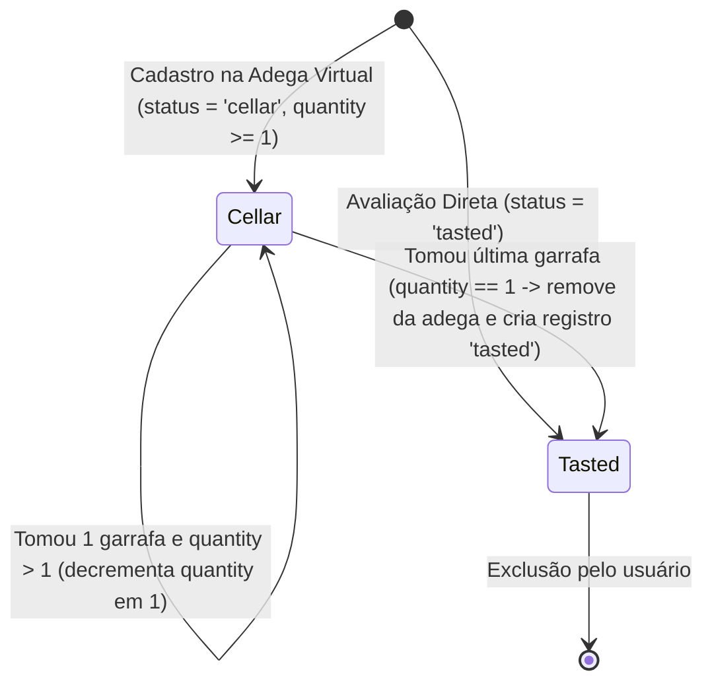

# Arquitetura de Software e Engenharia de Dados — VinoMemo

Este documento descreve a arquitetura técnica, os fluxos de dados, o protocolo de sincronização *Offline-First* e o ciclo de vida das entidades do **VinoMemo**.

---

## 1. Visão Geral da Arquitetura

O **VinoMemo** utiliza uma arquitetura **Local-First / Offline-First PWA** combinada com persistência em nuvem via **Supabase (PostgreSQL + PostgREST)**.

### Princípios de Engenharia Adotados
1. **Zero-Build Runtime:** A aplicação web principal (`index.html`, `styles.css`, `db.js`, `app.js`) roda diretamente em qualquer servidor estático (como GitHub Pages) sem exigir transpilação para o deploy.
2. **Resiliência em Camadas (3-Tier Storage):**
   - **Camada 1 (Primária Local):** `IndexedDB` (`VinoMemoDB` → store `wines`), capaz de armazenar centenas de registros com fotos em alta resolução.
   - **Camada 2 (Fallback Local):** `localStorage` (`vinomemo_wines_storage_v1`), acionado automaticamente caso o navegador/WebView restrinja o `IndexedDB` (ex: abertura via protocolo `file://` em dispositivos móveis).
   - **Camada 3 (Nuvem & Multi-Dispositivo):** `Supabase PostgreSQL` (ou `Firebase Realtime Database`), garantindo backup contínuo na nuvem e sincronização entre celular e desktop.

---

## 2. Diagrama de Fluxo de Dados e Sincronização

```mermaid
flowchart TD
    UI["Interface do Usuário (app.js)"]
    IMG["Pipeline de Compressão Canvas (compressImageFile)"]
    DB["Camada de Abstração de Dados (WineDatabase em db.js)"]
    IDB[("IndexedDB (VinoMemoDB)")]
    LS[("LocalStorage Fallback")]
    SYNC["Gerenciador de Sincronização (CloudSyncManager)"]
    SUPA[("Supabase PostgreSQL (public.wines)")]

    UI -->|Upload de Foto| IMG
    IMG -->|JPEG Base64 Otimizado <= 1000px| UI
    UI -->|CRUD Rótulo / Adega| DB
    DB -->|Escrita Imediata| IDB
    DB -.->|Fallback se IndexedDB indisponível| LS
    DB -->|Upsert Assíncrono| SYNC
    SYNC -->|REST API / JSONB| SUPA
    SUPA -->|Pull & Merge LWW (updatedAt)| DB
```

---

## 3. Algoritmo de Sincronização e Resolução de Conflitos (LWW)

Quando o aplicativo é iniciado (`WineDatabase.getAllWines()`), ele executa uma reconciliação bidirecional baseada em **Last-Write-Wins (LWW)** utilizando o atributo ISO-8601 `updatedAt`:

1. **Leitura Local:** Carrega todos os registros locais do `IndexedDB` (ou `localStorage`) em um mapa indexado por `id`.
2. **Leitura Remota (Pull):** Consulta a API REST do Supabase filtrando pela partição lógica `cellar_id`.
3. **Reconciliação (Merge):**
   - Para cada registro vindo da nuvem (`cw`) comparado ao registro local (`lw`):
     - Se `lw` não existir localmente, ou se `cw.updatedAt >= lw.updatedAt`, o registro da nuvem prevalece e atualiza o cache local (`importManyLocalOnly`).
   - Para cada registro local (`lw`) que ainda não existe na nuvem (criado enquanto o dispositivo estava offline):
     - É enviado em lote para a nuvem (`pushAllToCloud`).

---

## 4. Máquina de Estados do Vinho (`cellar` vs. `tasted`)

Tanto os vinhos guardados na **Adega Virtual** quanto os vinhos **Tomados/Avaliados** compartilham a mesma estrutura de armazenamento (`wines`), diferenciados pelo atributo `status`:



### Integração Adega Virtual → Avaliação (`openEvaluateFromCellarModal`)
Quando o usuário clica em **"🍷 Tomei! Avaliar agora"** em um item da Adega Virtual:
1. O modal de avaliação é pré-populado com `name`, `type`, `grapes`, `country`, `vintage` e `labelPhoto` da garrafa guardada.
2. O campo oculto `fromCellarWineId` recebe o `id` original da garrafa da adega.
3. No `submit` da avaliação:
   - Se `cellarOrigin.quantity > 1`, o sistema reduz `quantity` em `-1` e persiste na Adega Virtual.
   - Se `cellarOrigin.quantity === 1`, o item é removido da Adega Virtual (`deleteWine(fromCellarId)`) e salvo como um registro completo avaliado (`status: 'tasted'`).

---

## 5. Pipeline de Otimização de Imagens (Client-Side ETL)

Para evitar gargalos de rede e limites de payload no banco de dados sem depender de buckets externos pagos:
- A função `compressImageFile(file, maxDimension = 1000, quality = 0.8)` redimensiona proporcionalmente qualquer foto da câmera do celular (frequentemente de 4000x3000px / 6MB) para no máximo `1000px` no maior eixo e codifica em JPEG com qualidade `0.80` (~80KB a 150KB por foto).
- Caso o usuário não envie foto do rótulo, a função determinística `generateWineLabelIllustration()` renderiza dinamicamente um SVG vetorial parametrizado pelas cores do estilo do vinho (`Tinto`, `Branco`, `Rosé`, `Espumante`, `Sobremesa/Fortificado`).
